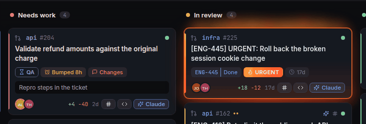
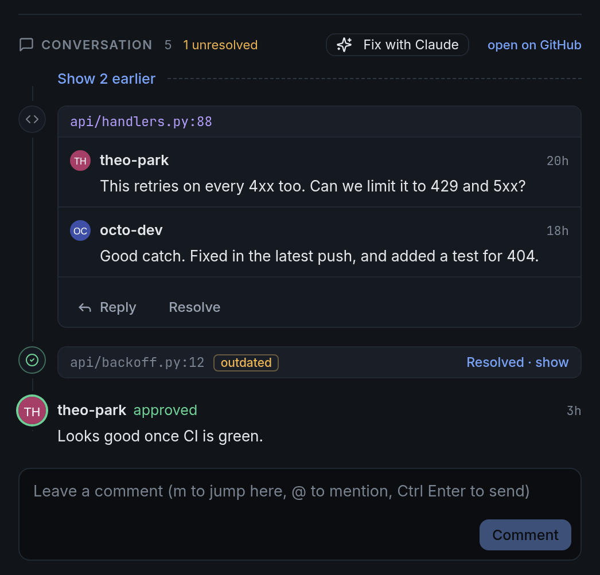
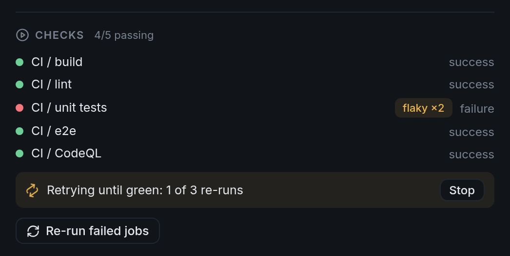
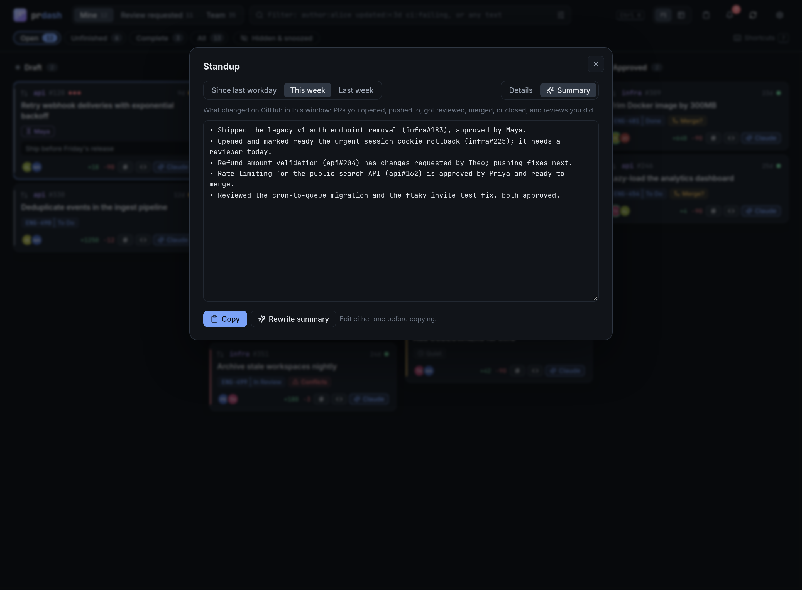
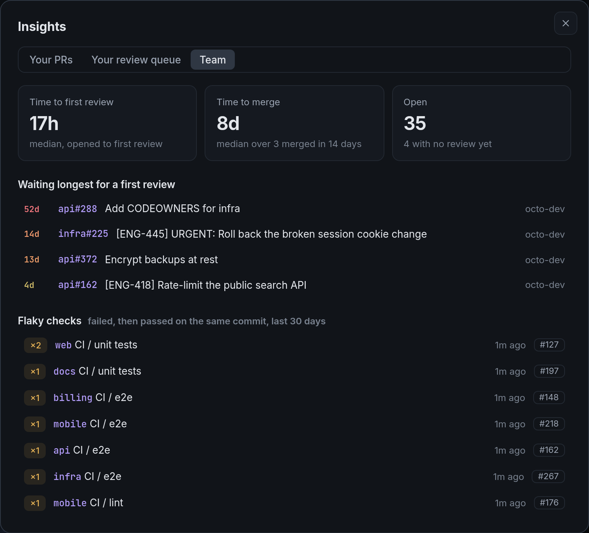

<div align="center">


# prdash

**A dashboard for the pull requests you care about, running on your own machine.**<br>
Your PRs, your review queue, and your team's work on one board, with an inbox for what changed,<br>
AI reviews from the model you pick, and Slack and Jira alongside each PR.

<p>


<a href="https://github.com/NathanYearout/prdash/actions/workflows/ci.yml"></a>


</p>

[Quick start](#quick-start) · [Features](#features) · [Filters](#filter-syntax) · [Keyboard](#keyboard) · [Settings](#settings) · [How it works](#how-it-works)

<br>

<picture>
  <source media="(prefers-color-scheme: light)" srcset="docs/board-light.png">
  
</picture>

</div>

## Quick start

You need Python 3.10+ and the [GitHub CLI](https://cli.github.com/), signed in with `gh auth login`.

```sh
pipx install git+https://github.com/NathanYearout/prdash   # or: uv tool install git+https://github.com/NathanYearout/prdash
prdash                                                      # opens http://127.0.0.1:8765
```

A short setup screen confirms your GitHub login, the orgs to track, where your clones live, and your terminal and editor. The first sync takes a few seconds. After that the board loads from a local cache and updates as your PRs change.

```sh
prdash --demo                 # look around with a fictional org first; nothing touches GitHub
prdash service install        # start at login (systemd on Linux, launchd on macOS), then `prdash` just opens it
```

Running `prdash` again reopens the dashboard. prdash also keeps itself current: a git checkout pulls new commits when it starts (unless you have local changes), and a pipx install upgrades once a day. Turn this off with `--no-update` or in Settings. To open it in another browser, `prdash url` prints a one-time login link.

## Features

<table>
<tr>
<td width="50%" valign="top">

### One board
Draft → Needs work → In review → Approved → Merged across every org you pick. **Needs work** says why: failing CI, requested changes, or conflicts. Push new commits after a change request and the PR goes back to In review, with a button to re-request review from the people who asked for changes (the person, not the team they were requested through). Cards nudge you when an approved PR sits unmerged or a review goes quiet.

</td>
<td width="50%"></td>
</tr>
<tr>
<td colspan="2" align="center">

### Urgent and bumped PRs
Put **urgent** in a title (or add an `urgent` label) and the card gets a red ring with a highlight that travels around its edge, and it moves to the top of its column. If your system asks for reduced motion, the ring stays and the highlight holds still. When someone comments **bump**, the card shows who bumped it and when, and the bump shows up in your inbox.



</td>
</tr>
<tr>
<td></td>
<td valign="top">

### AI reviews
**Open in Claude** starts a session in the PR's repo with its description, comments, and diff loaded. **Review** runs read-only in the background and adds a summary, a list of issues with `file:line`, and a verdict to the card. You can review one PR or a whole selection. It works with [Claude Code, Codex, or any OpenAI-compatible API](#ai-providers), including DeepSeek, Grok, Gemini, OpenRouter, and a local Ollama.

</td>
</tr>
<tr>
<td valign="top">

### Comments and threads
The PR panel shows the description, comments, and reviews formatted the way GitHub shows them. Code comments are threads you can reply to and resolve without leaving the board, and resolved ones fold away. On your own PR, **Fix with Claude** opens your AI in the PR's worktree with every unresolved comment loaded; it asks before it changes a file and never commits or pushes. Press `m` to comment on whatever PR you're looking at.

</td>
<td></td>
</tr>
<tr>
<td></td>
<td valign="top">

### Flaky checks, retried until green
When a check fails and then passes on the same commit, prdash records it as a flake and marks it in the checks list with a count. **Retry until green** re-runs the failed GitHub Actions jobs each time they fail, up to a limit you set (3 by default). It stops when CI passes, when you push new commits, when it runs out of attempts, or when you press Stop, and your inbox says how it ended. You can also have it start by itself on your PRs when every failing check is a known flake.

</td>
</tr>
<tr>
<td valign="top">

### Filters
`reviewer:alice updated:<3d -is:draft`, `size:>500 ci:failing`, `author:alice,bob merged:<7d`. You can also put them together in the filter builder, which lists the people in your orgs, and save any filter as a chip.

</td>
<td></td>
</tr>
<tr>
<td></td>
<td valign="top">

### Keyboard shortcuts
`Ctrl K` finds any action or PR. `j`/`k` walk the queue with the panel open, so reviewing a stack is one key per PR. Single keys approve, open in Claude, start a review, open your editor, or snooze.

</td>
</tr>
<tr>
<td valign="top">

### Notifications
New review requests, bumps, approvals and change requests, comments (with who wrote them and what they said), @mentions on any PR, new commits after your change request, CI going red or green, conflicts, merges, and finished Claude reviews. They show up in the inbox and as browser notifications, and reach your desktop when no tab is open (prdash uses `notify-send` or `terminal-notifier` if you have one). Urgent review requests stay on screen until you dismiss them. Filter the inbox to mentions, delete items, mute a PR, or follow someone else's PR to get its updates like your own.

</td>
<td></td>
</tr>
<tr>
<td></td>
<td valign="top">

### Standup notes
Pick since your last workday, this week, or last week to see what shipped, what you pushed to or got reviewed, what you opened or closed, and the reviews you did. **Summarize** has a smaller model from your AI provider turn that into a few first-person bullets you can paste into standup.

</td>
</tr>
<tr>
<td valign="top">

### Insights and PR age
`s` shows the median time to first review and to merge for your PRs, your review queue, or the team, the PRs that have waited longest for a first review, and the checks that flake most. On the board, `g` colors open PRs by how long they've been open: green when new, amber around a week, red around a month, and an increasingly red card up to six months, with the oldest first in each column.

</td>
<td></td>
</tr>
<tr>
<td></td>
<td valign="top">

### Setup
prdash finds your GitHub login, your orgs, the folders where your clones live, your terminal and editor, and which AI you have (Claude Code, Codex, Gemini, or an API), and turns on notifications. You can change any of it later in Settings.

</td>
</tr>
</table>

### And also

- **Your checkouts:** clone a repo, check out the PR branch, or create a worktree per PR, then open your editor (`code`, `nvim` in your terminal, anything) or a terminal there.
- **Stacked PRs:** a PR whose base is another open PR's branch shows the whole stack, and cards say what they're stacked on.
- **CI:** every check on the latest commit with links, and one click to re-run the failed GitHub Actions jobs.
- **Your own layer:** priority, tags, notes, "waiting on", snooze until a date, and hide. These stay in prdash's database and never go to GitHub.
- **Batch actions:** select with `x` or shift-click, then rebase, approve, re-run CI, AI-review, snooze, tag, or hide them together.
- **Slack:** post the announcement (`PR to fix the thing: <link>`), find it if someone posted by hand, and see thread replies and reactions on the PR.
- **Jira:** ticket status and assignee on every card, and optionally move the ticket when your PR merges.
- **Ten themes** (Nord, Dracula, Tokyo Night, Catppuccin, Gruvbox, Solarized, and more), or follow your system's light/dark setting.

## Filter syntax

Terms AND together, commas OR within a term, and a leading `-` negates. Bare words search titles, repos, branches, tickets, tags, and your notes.

| Filter | Matches |
|---|---|
| `author:alice,bob` · `-author:dependabot` | Opened by any of these (or not) |
| `reviewer:alice` · `requested:alice` · `approved-by:alice` | Reviewer in any state · review requested · approved |
| `repo:web` · `org:acme` · `label:bug` · `tag:blocked` · `jira:ENG-4` | Substring and prefix matches |
| `updated:<3d` · `created:>2w` · `merged:<7d` | Within or older than: `h` `d` `w` `m` `y` |
| `size:>500` · `size:xl` · `files:>20` · `comments:>5` · `prio:>=2` | Numbers; sizes are xs s m l xl |
| `ci:failing` · `review:changes` | CI: failing passing pending none · review: approved changes needed none |
| `is:urgent` · `is:bumped` · `is:stale` · `is:mine` | Also draft, open, merged, approved, needs-work, in-review, conflict, posted, snoozed, hidden |
| `is:pushed` · `is:mentioned` · `is:retrying` | New commits since changes requested · @mentions you · retrying until green. Also following, muted |
| `has:threads` · `threads:>2` · `has:jira` · `-has:note` | Unresolved review threads. Also tags, waiting, review (AI), labels, reviewers |

## Keyboard

| Key | | Key | |
|---|---|---|---|
| `Ctrl K` | Command palette | `c` `v` | Open in your AI · AI review |
| `/` `f` | Search · filter builder | `e` `w` | Editor · worktree |
| `j` `k` `Enter` | Move · open (walks the queue when open) | `p` `y` `O` | Announce in Slack · copy link · GitHub |
| `x` `X` | Select · select all | `a` | Approve (press twice) |
| `1` `2` `3` | Mine · Review requested · Team | `z` `h` | Snooze a day · hide |
| `b` `t` | Board · table | `i` `u` `s` | Inbox · standup · insights |
| `m` | Comment on the PR | `g` | Color PRs by age |
| `,` `r` `?` | Settings · sync · help | | |

## Settings

Everything is on the settings page (`,`) and stored in prdash's local database. Environment variables (`PRDASH_<NAME>`, e.g. `PRDASH_ORGS=acme,acme-labs`) work as defaults, and `prdash service install` copies them into the service.

| Section | Options |
|---|---|
| Appearance | Ten themes: System, Midnight, Daylight, Nord, Dracula, Tokyo Night, Catppuccin, Gruvbox, Solarized, Rosé Pine Dawn |
| GitHub | Orgs (default: all of yours), extra search filter, team view, merged window, sync interval, merge method, nudge age, update on start |
| Local | Clone folders, worktree folder, terminal command, editor command |
| AI | Provider, CLI path, review and summary models, interactive command, API URL/key/model, extra review instructions |
| CI | Retry until green: how many re-runs, and whether to start it on its own for known-flaky checks |
| Notifications | Browser notifications, a notify command for when no tab is open |
| Slack | User token, channel, announcement template |
| Jira | Site URL, email and API token, status to move tickets to on merge |

## AI providers

Pick one on the setup screen or in Settings → AI, then hit **Test**. prdash fetches the PR's description, comments, and diff itself and sends only those to the provider.

| Provider | Reviews and standup summaries | Open in… (terminal session) |
|---|---|---|
| **Claude Code** (`claude`) | `claude -p` in `dontAsk` mode from an empty folder: no shell, reads only the PR's checkout | `claude --permission-mode plan` |
| **Codex CLI** (`codex`) | `codex exec --sandbox read-only` from an empty folder (no network) | `codex --sandbox read-only` |
| **OpenAI-compatible API** | One chat completion, no tools | Your own command, e.g. `aider --model deepseek/deepseek-chat --message {prompt}` |

API presets: DeepSeek `https://api.deepseek.com` (`deepseek-chat`), Grok `https://api.x.ai/v1` (`grok-4`), OpenAI `https://api.openai.com/v1`, Gemini `https://generativelanguage.googleapis.com/v1beta/openai` (`gemini-2.5-flash`), OpenRouter `https://openrouter.ai/api/v1` (hundreds of models), Ollama `http://localhost:11434/v1` (local, no key). Buttons take the provider's name ("Open in Codex", "Grok review"). Headless runs never start inside a PR's checkout, so a PR can't ship its own agent config, hooks, or MCP servers into your review. Gemini CLI isn't offered for headless runs because its read-only mode still allows web fetches; use Gemini through the API instead.

## How it works

- **Backend:** a small Python standard-library server that talks to GitHub through `gh`, with a SQLite cache in `~/.config/prdash` (set `PRDASH_HOME` to move it).
- **Sync:** each run finds every view's PRs with GitHub search, then fetches details in parallel batches of 25. Refreshing ~250 PRs takes 7 to 10 seconds; merged PRs are fetched once. Changes between syncs become inbox events and are pushed to open tabs over server-sent events.
- **Frontend:** Alpine.js with no build step. Cards render as HTML strings and the PR data stays outside Alpine's reactivity, so a 200-PR board renders in a couple hundred milliseconds.
- **AI:** for reviews and summaries, prdash fetches the PR description, comments, and diff itself and hands them to the provider as data, with CLIs in their read-only modes (see [AI providers](#ai-providers)). Interactive sessions start read-only too. Every prompt tells the model to treat PR content as untrusted.
- **Security:** listens only on `127.0.0.1` and checks the `Host` header. The `prdash` command opens a one-time login link that starts a 7-day browser session (an HttpOnly, SameSite=Strict cookie, never the API token). Because browsers share cookies across localhost ports, API calls must also come from prdash's own origin, and writes carry a per-session CSRF token. `prdash logout` ends every session. Actions only run on PRs in your configured orgs. Links from CI providers must be `http(s)`. Slack and Jira tokens live in an owner-only directory and are never sent to the page.

## Development

```sh
python3 -m prdash --no-open --port 8766        # PRDASH_HOME=/tmp/x for a scratch database, --demo for fake data
python3 -m unittest discover tests            # backend, Slack/Jira against stub servers, server security
node --test tests/*.test.mjs                  # filter language, markdown rendering
node tests/e2e.mjs http://127.0.0.1:8766/     # headless Chromium walkthrough (needs chromium)
node tests/screenshots.mjs                    # regenerate docs/*.png and docs/urgent.gif from a --demo server on :8770 (same PRDASH_HOME)
```

CI runs the tests on every push. When the UI changes, a second workflow starts demo mode, re-renders the README screenshots and GIF in headless Chrome, and commits any that changed.

Board status lives in `status()` in `prdash/github.py`, inbox rules in `diff()` in `prdash/sync.py`, filter keys in `prdash/web/js/filter.js`, and settings in `FIELDS` in `prdash/config.py`.

## License

[Apache License 2.0](LICENSE). You're free to use, modify, and redistribute prdash; forks and redistributions must keep the copyright notice and the [NOTICE](NOTICE) file crediting the original author.
