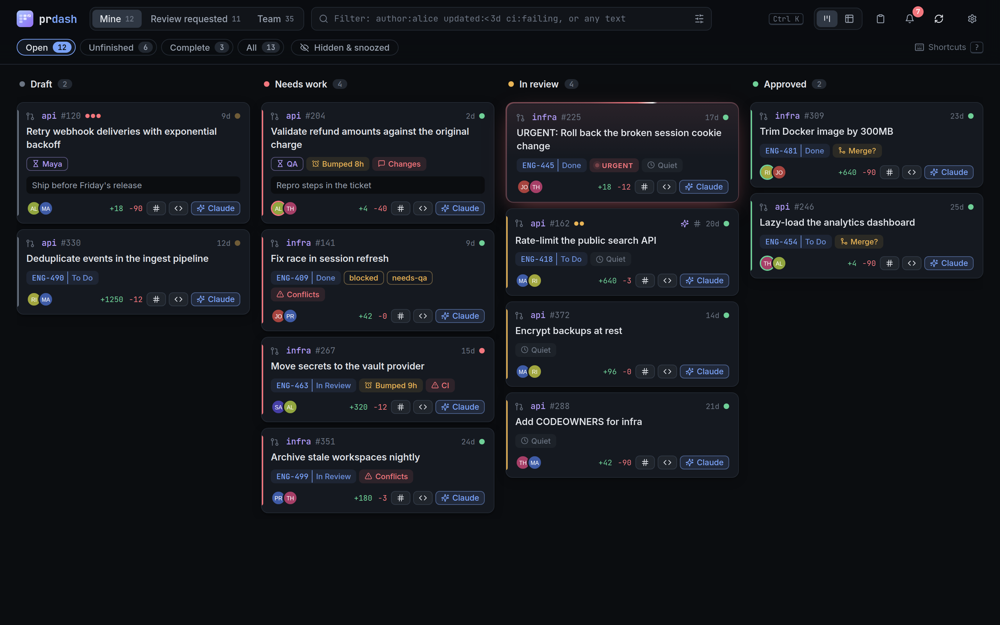
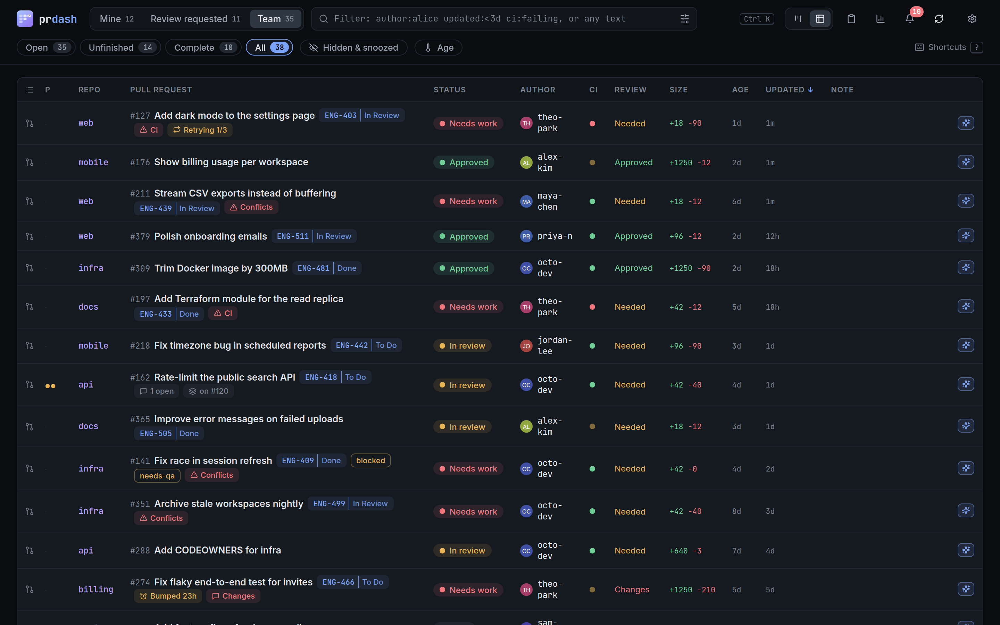
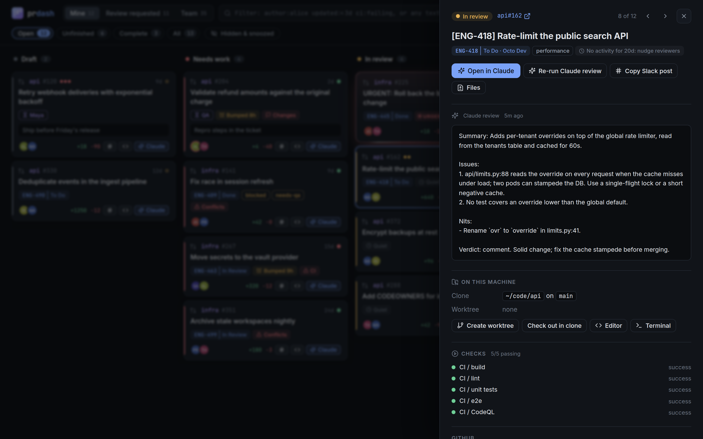
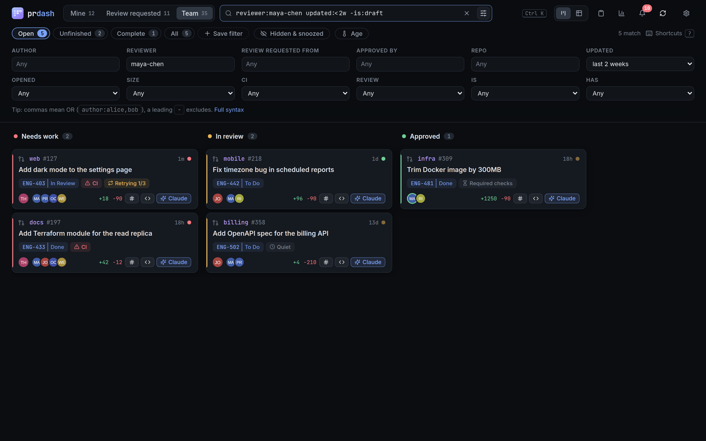
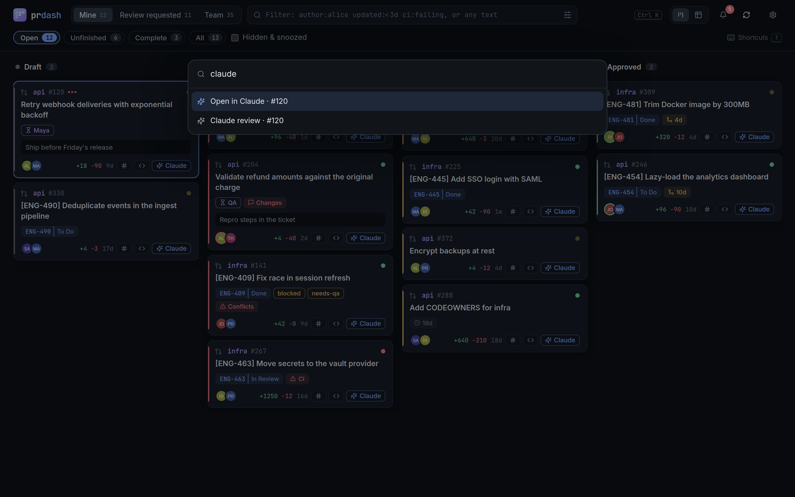
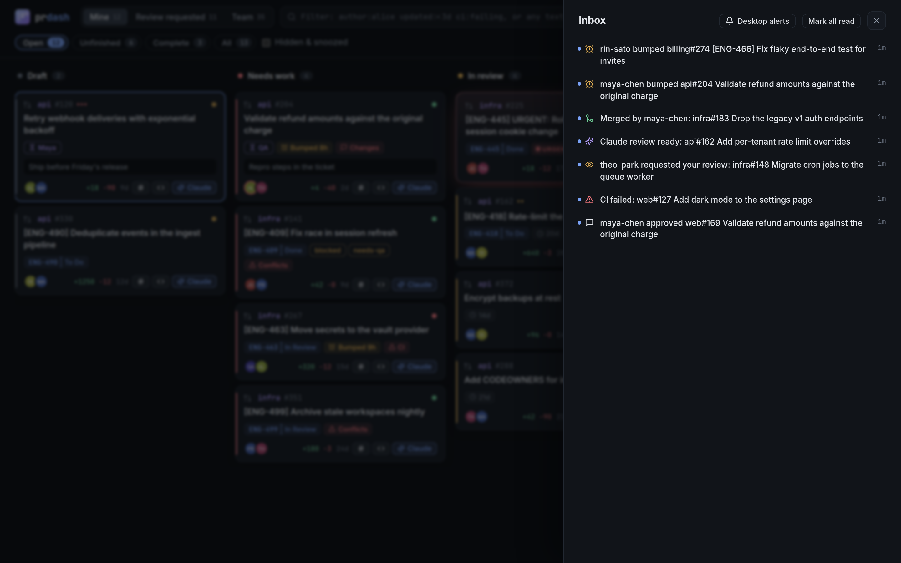
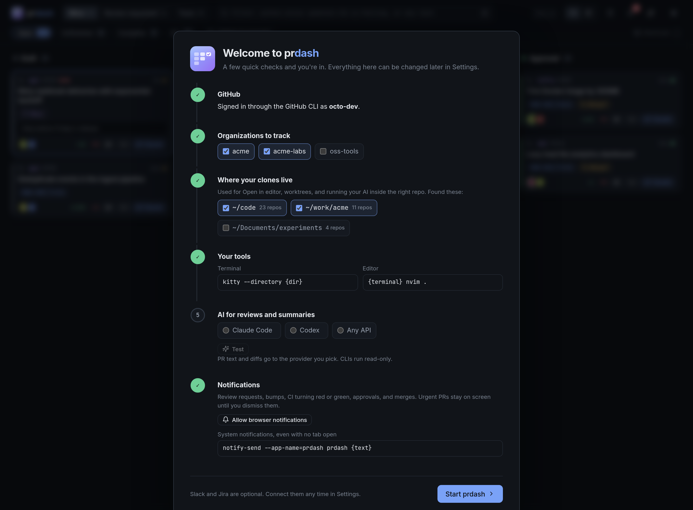

<div align="center">


# prdash

**A fast, local dashboard for every pull request you care about.**<br>
Your PRs, your review queue, and your team's work on one board, with an inbox for what changed,<br>
Claude Code reviews, and Slack and Jira wired in. Runs on your machine. No accounts, no cloud.

<p>


</p>

[Quick start](#quick-start) · [Features](#features) · [Filters](#filter-syntax) · [Keyboard](#keyboard) · [Settings](#settings) · [How it works](#how-it-works)

<br>

<picture>
  <source media="(prefers-color-scheme: light)" srcset="docs/board-light.png">
  
</picture>

</div>

## Quick start

You need Python 3.10+ and the [GitHub CLI](https://cli.github.com/), signed in with `gh auth login`.

```sh
pipx install git+https://github.com/NathanYearout/prdash   # or: uv tool install git+https://github.com/NathanYearout/prdash
prdash                                                      # opens http://127.0.0.1:8765
```

A short setup screen confirms your GitHub login, the orgs to track, where your clones live, and your terminal and editor. The first sync takes a few seconds. After that the board loads instantly from a local cache and stays live.

```sh
prdash --demo                 # look around with a fictional org first; nothing touches GitHub
prdash service install        # start at login (systemd on Linux, launchd on macOS), then `prdash` just opens it
```

Running `prdash` while it's already running just reopens the dashboard. For another browser, `prdash url` prints a one-time login link.

## Features

<table>
<tr>
<td width="50%" valign="top">

### One board for everything
Draft → Needs work → In review → Approved → Merged across every org you pick. **Needs work** says why: failing CI, requested changes, or conflicts. Cards nudge you when an approved PR sits unmerged or a review goes quiet.

</td>
<td width="50%"></td>
</tr>
<tr>
<td></td>
<td valign="top">

### Claude Code built in
**Open in Claude** starts a session in the right repo with the PR's description, comments, and diff loaded. **Claude review** runs in the background, read-only, and puts a summary, issues with `file:line`, and a verdict on the card. Run it on one PR or a whole selection.

</td>
</tr>
<tr>
<td valign="top">

### Filters you can type
`reviewer:alice updated:<3d -is:draft`, `size:>500 ci:failing`, `author:alice,bob merged:<7d`. Or click them together in the builder, which lists the people in your orgs. Save any filter as a chip.

</td>
<td></td>
</tr>
<tr>
<td></td>
<td valign="top">

### Keyboard-first
`Ctrl K` finds any action or PR. `j`/`k` walk the queue with the panel open, so reviewing a stack is one key per PR. Single keys approve, open in Claude, start a review, open your editor, or snooze.

</td>
</tr>
<tr>
<td valign="top">

### An inbox for what changed
New review requests, approvals and change requests, comments, CI going red or green, conflicts, merges, finished Claude reviews. You get browser notifications, or system notifications through any command (`notify-send prdash {text}`) even with no tab open.

</td>
<td></td>
</tr>
<tr>
<td></td>
<td valign="top">

### Set up in a minute
prdash finds your GitHub login, your orgs, the folders where your clones live, your terminal and editor, and whether Claude Code is installed. Everything is editable later on the settings page.

</td>
</tr>
</table>

### And also

- **Your checkouts:** clone a repo, check out the PR branch, or create a worktree per PR, then open your editor (`code`, `nvim` in your terminal, anything) or a terminal there.
- **CI:** every check on the latest commit with links, and one click to re-run the failed GitHub Actions jobs.
- **Your own layer:** priority, tags, notes, "waiting on", snooze until a date, and hide. Stored locally, never sent to GitHub.
- **Batch actions:** select with `x` or shift-click, then rebase, approve, re-run CI, Claude-review, snooze, tag, or hide them together.
- **Slack:** post the announcement (`PR to fix the thing: <link>`), find it if someone posted by hand, and see thread replies and reactions on the PR.
- **Jira:** ticket status and assignee on every card, and optionally move the ticket when your PR merges.
- **Standup:** a summary of what merged since your last workday, what's ready to merge, in review, and stuck, ready to paste.
- **Light and dark** themes follow your system.

## Filter syntax

Terms AND together, commas OR within a term, and a leading `-` negates. Bare words search titles, repos, branches, tickets, tags, and your notes.

| Filter | Matches |
|---|---|
| `author:alice,bob` · `-author:dependabot` | Opened by any of these (or not) |
| `reviewer:alice` · `requested:alice` · `approved-by:alice` | Reviewer in any state · review requested · approved |
| `repo:web` · `org:acme` · `label:bug` · `tag:blocked` · `jira:ENG-4` | Substring and prefix matches |
| `updated:<3d` · `created:>2w` · `merged:<7d` | Within or older than: `h` `d` `w` `m` `y` |
| `size:>500` · `size:xl` · `files:>20` · `comments:>5` · `prio:>=2` | Numbers; sizes are xs s m l xl |
| `ci:failing` · `review:changes` | CI: failing passing pending none · review: approved changes needed none |
| `is:draft` · `is:stale` · `is:mine` · `is:conflict` | Also open, merged, approved, needs-work, in-review, posted, snoozed, hidden |
| `has:jira` · `-has:note` | Also tags, waiting, review (Claude), labels, reviewers |

## Keyboard

| Key | | Key | |
|---|---|---|---|
| `Ctrl K` | Command palette | `c` `v` | Open in Claude · Claude review |
| `/` `f` | Search · filter builder | `e` `w` | Editor · worktree |
| `j` `k` `Enter` | Move · open (walks the queue when open) | `p` `y` `O` | Announce in Slack · copy link · GitHub |
| `x` `X` | Select · select all | `a` | Approve (press twice) |
| `1` `2` `3` | Mine · Review requested · Team | `z` `h` | Snooze a day · hide |
| `b` `t` | Board · table | `i` `u` `,` `r` `?` | Inbox · standup · settings · sync · help |

## Settings

Everything is on the settings page (`,`) and stored in prdash's local database. Environment variables (`PRDASH_<NAME>`, e.g. `PRDASH_ORGS=acme,acme-labs`) work as defaults, and `prdash service install` copies them into the service.

| Section | Options |
|---|---|
| GitHub | Orgs (default: all of yours), extra search filter, team view, merged window, sync interval, merge method, nudge age |
| Local | Clone folders, worktree folder, terminal command, editor command |
| Claude | CLI path, extra review instructions (house style, a skill to use) |
| Notifications | Browser notifications, a notify command for when no tab is open |
| Slack | User token, channel, announcement template |
| Jira | Site URL, email and API token, status to move tickets to on merge |

## How it works

- **Backend:** a small Python standard-library server that talks to GitHub through `gh`, with a SQLite cache in `~/.config/prdash` (set `PRDASH_HOME` to move it).
- **Sync:** each run finds every view's PRs with GitHub search, then fetches details in parallel batches of 25. Refreshing ~250 PRs takes 7 to 10 seconds; merged PRs are fetched once. Changes between syncs become inbox events and are pushed to open tabs over server-sent events.
- **Frontend:** Alpine.js with no build step. Cards render as HTML strings and the PR data stays outside Alpine's reactivity, so a 200-PR board renders in a couple hundred milliseconds.
- **Claude:** for reviews, prdash fetches the PR description, comments, and diff itself and hands them to `claude -p` as data. Claude runs in `dontAsk` mode with no shell, and may only read files inside the PR's checkout. Open in Claude starts an interactive session in plan mode. Both are told to treat PR content as untrusted.
- **Security:** listens only on `127.0.0.1` and checks the `Host` header. The `prdash` command opens a one-time login link that starts a 7-day browser session (an HttpOnly, SameSite=Strict cookie, never the API token). Because browsers share cookies across localhost ports, API calls must also come from prdash's own origin, and writes carry a per-session CSRF token. `prdash logout` ends every session. Actions only run on PRs in your configured orgs. Links from CI providers must be `http(s)`. Slack and Jira tokens live in an owner-only directory and are never sent to the page.

## Development

```sh
python3 -m prdash --no-open --port 8766        # PRDASH_HOME=/tmp/x for a scratch database, --demo for fake data
python3 -m unittest discover tests            # backend, Slack/Jira against stub servers, server security
node --test tests/filter.test.mjs             # filter language
node tests/e2e.mjs http://127.0.0.1:8766/     # headless Chromium walkthrough (needs chromium)
node tests/screenshots.mjs                    # regenerate docs/*.png from a --demo server on :8770 (same PRDASH_HOME)
```

Board status lives in `status()` in `prdash/github.py`, inbox rules in `diff()` in `prdash/sync.py`, filter keys in `prdash/web/js/filter.js`, and settings in `FIELDS` in `prdash/config.py`.

## License

[Apache License 2.0](LICENSE). You're free to use, modify, and redistribute prdash; forks and redistributions must keep the copyright notice and the [NOTICE](NOTICE) file crediting the original author.
